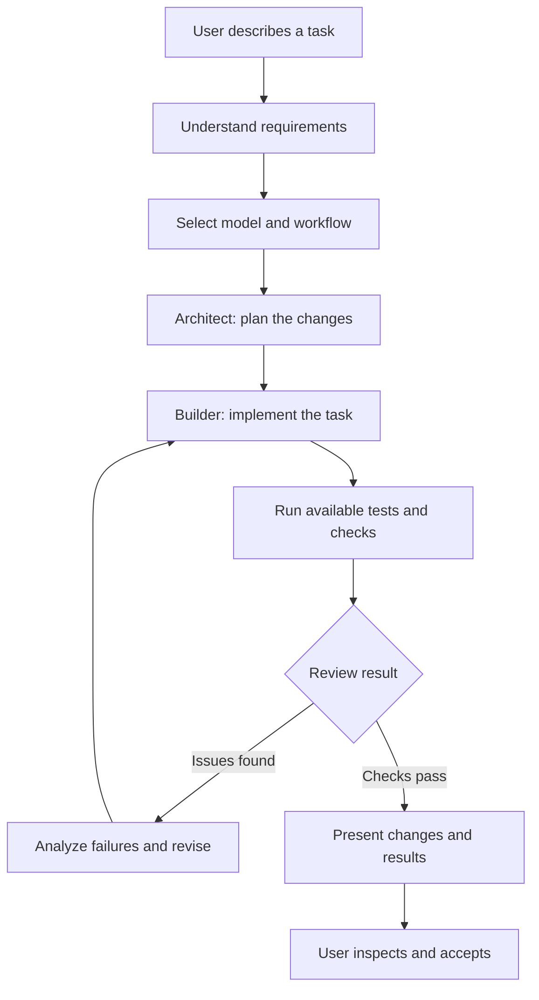
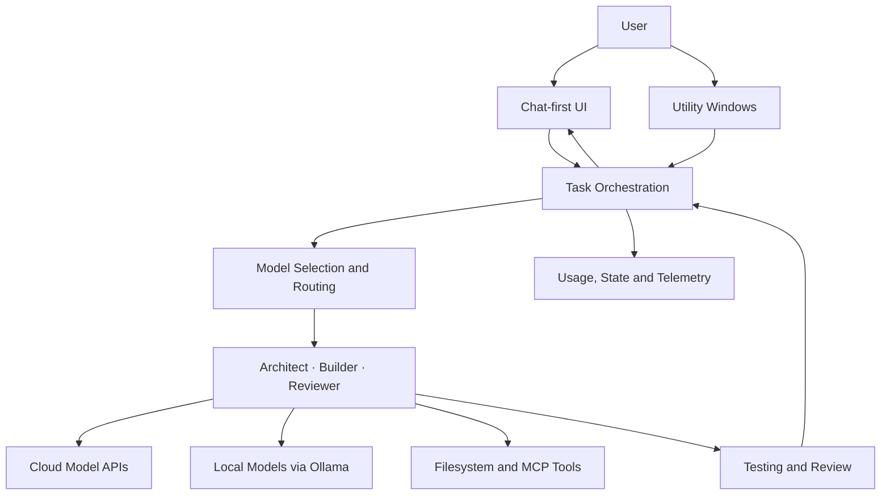

# AgentUFO 🚀
### An AI-powered development environment for orchestrating models, tools, and software engineering workflows.

**One workspace. Multiple models. A structured path from idea to implementation.**

AgentUFO is an AI-powered development environment designed to bring conversational AI, multi-model routing, agent-based software development, and engineering verification into a unified workspace.

Instead of treating AI as a chatbot that only generates code snippets, AgentUFO explores a more structured approach: describe a task in natural language, route work through specialized roles, interact with project files, track execution, and review changes before accepting them.

The objective is simple: **make AI-assisted software development more capable, observable, and cost-conscious without losing control over the engineering process.**

<!-- Replace these paths with real screenshots and GIFs from the application. -->
<p align="center">
  
</p>

<p align="center">
  <a href="#-overview">Overview</a> •
  <a href="#-key-features">Features</a> •
  <a href="#-how-it-works">Workflow</a> •
  <a href="#-architecture">Architecture</a> •
  <a href="#-getting-started">Getting Started</a> •
  <a href="#-roadmap">Roadmap</a>
</p>

---

## 🎬 See AgentUFO in Action

The interface is designed around a familiar chat-first experience. The main workspace stays focused on the task, while dedicated tools provide visibility into routing, agent activity, budgets, and integrations.

| Main workspace | Agent orchestration |
|---|---|
|  |  |
| Describe a task, select a model, and interact with the development workflow. | Inspect task progress, agent roles, and execution state. |

### A closer look

**Multi-model routing and token efficiency**


**Live crew tracking and execution controls**


**MCP Studio and tool integration workflows**


> These image paths are intended as repository assets. Add real screenshots or recorded GIFs at the corresponding paths before publishing the README; the placeholders are not live product captures.

---

## 🧭 Overview

Modern AI coding workflows often involve a collection of disconnected tools: one interface for chatting, another for editing files, separate model APIs, custom scripts for automation, and limited visibility into what an agent is doing.

AgentUFO brings these concerns together into a single development environment.

Its design combines:

- **Conversational development:** express requirements naturally instead of manually coordinating every low-level operation.
- **Multi-model workflows:** select models and route different responsibilities to appropriate providers.
- **Agent-based task decomposition:** organize development work around roles such as Architect, Builder, and Reviewer.
- **Local and cloud inference:** support workflows involving local models through Ollama and cloud model APIs.
- **Execution visibility:** inspect agent activity, task state, and operational controls.
- **Tool integration:** develop and test Model Context Protocol (MCP) integrations.
- **Engineering verification:** incorporate testing and review gates into the development workflow.
- **Resource awareness:** track token usage and budgets, and reduce unnecessary model calls and retained context.

The project is built around a broader idea: useful AI engineering systems need more than capable models. They also need orchestration, state management, observability, reliable tool execution, and mechanisms for checking the work those models produce.

## ✨ Key Features

### 💬 1. Chat-first development workspace

The main interface is designed to feel familiar to anyone who has used a conversational AI assistant.

Users can describe what they want to build, discuss implementation choices, and initiate structured development tasks without navigating through a collection of disconnected dashboards.

The chat workspace is intended to remain the primary experience. Supporting capabilities live in dedicated utility windows rather than competing with the conversation for screen space.

**Design principles**
- Keep the user's task and conversation at the center.
- Make model selection explicit.
- Support natural-language task descriptions.
- Separate everyday interaction from operational controls.
- Keep project files accessible without turning file navigation into the main experience.

### 🧠 2. Multi-model routing and token efficiency

Different models have different capabilities, latency profiles, context limits, and costs. Using the same expensive model for every operation is not always the best engineering decision.

AgentUFO is designed to support model selection and routing strategies that match model usage to the task.

Potential routing decisions include:

- Using a stronger model for architectural reasoning or complex planning.
- Delegating suitable implementation subtasks to less expensive models.
- Using local models for compatible operations when their capabilities are sufficient.
- Limiting unnecessary context and repeated requests.
- Applying token and budget awareness when coordinating work.

The goal is not simply to minimize tokens. It is to improve the relationship between **output quality, execution time, and inference cost**.

Actual savings depend on the selected models, task complexity, routing policy, and provider pricing; they should be measured rather than assumed.

### 👥 3. Structured agent workflows

AgentUFO organizes development work around specialized responsibilities rather than treating every operation as an undifferentiated conversation.

A representative workflow uses three roles:

| Role | Responsibility |
|---|---|
| **Architect** | Understand requirements, plan the implementation, and identify relevant components. |
| **Builder** | Implement the proposed changes and work with the relevant project files. |
| **Reviewer** | Inspect the result, identify problems, and evaluate whether the requirements have been satisfied. |

The roles provide a useful separation of concerns:

- Planning determines what should change.
- Implementation determines how to make the change.
- Review evaluates the resulting work.

This separation also creates opportunities to use different models for different responsibilities.

**Important distinction:** specialized roles do not automatically imply simultaneous execution. The current orchestration approach includes sequential execution; genuine parallel agent execution remains a development goal.

### 📡 4. Live Crew Tracking

Agent workflows are easier to understand when their execution state is visible.

The Crew Tracking interface is intended to expose the state of agent-driven tasks and provide controls for observing and managing execution.

It complements the chat workspace by answering operational questions:

- Which role is currently active?
- What stage of the workflow is running?
- What work has been completed?
- Where is the process waiting or failing?
- What controls are available for the current task?

The emphasis is on making orchestration inspectable rather than hiding it behind a single loading indicator.

### 🎛️ 5. Control Room

The Control Room provides a dedicated place for operational visibility and control.

Rather than mixing every system setting into the main conversation, AgentUFO separates execution management from everyday interaction.

This creates a foundation for monitoring model usage, execution state, task controls, and resource constraints as the environment evolves.

### 🔌 6. MCP Studio

The Model Context Protocol (MCP) provides a standard way for AI applications to interact with external tools and contextual resources.

AgentUFO's MCP Studio focuses on making tool integration easier to inspect and work with.

Its intended workflow includes:

1. Define or configure an MCP integration.
2. Inspect the integration's configuration.
3. Generate or prepare the relevant server implementation.
4. Test the integration.
5. Connect compatible tools to a broader AI workflow.

MCP support is treated as an integration boundary, not a reason to trust arbitrary tools automatically. Production-grade deployments still require explicit permission handling, credential protection, input validation, and isolation for untrusted code.

MCP generation and testing should not be confused with automatic, unrestricted launching of arbitrary servers.

### 📁 7. Project and filesystem interaction

Software development agents need to work with real project artifacts, not only produce plausible-looking answers.

AgentUFO's development workflow includes filesystem-oriented operations so that tasks can interact with project files.

The interface keeps file access secondary to the conversation, with a compact file viewer or dropdown rather than a separate, permanently dominant workspace.

This design aims to preserve a clean interaction model while allowing users to inspect relevant artifacts when needed.

### 🧪 8. Testing and review gates

A generated code change is not necessarily a correct code change.

AgentUFO incorporates testing and review into the workflow so that implementation quality is evaluated separately from the model's confidence in its own output.

A robust verification cycle should:

- Identify the intended changes.
- Execute the available checks.
- Inspect failures rather than silently treating them as success.
- Review the implementation against the requirements.
- Surface unresolved issues before accepting the result.

The long-term goal is to make successful verification an explicit condition for accepting changes, with trustworthy execution results rather than model-generated claims of success.

Verification coverage depends on the configured tests and the checks actually executed. Passing tests are useful evidence, not a universal proof of correctness.

---

## 🔄 How It Works

AgentUFO follows a structured development workflow that moves from a natural-language request toward an implementation that can be inspected and tested.

### End-to-end workflow



This diagram describes the intended workflow, not a guarantee that every task automatically completes every stage. The available execution and verification steps depend on the configured environment.

### Step 1 — Describe the task

The user provides a request such as:

> Build a REST API for task management with authentication, persistent storage, input validation, and tests.

The system starts from the requirements rather than immediately generating arbitrary code.

### Step 2 — Plan the work

The Architect role identifies the major components, dependencies, implementation steps, and relevant constraints.

For a multi-file change, this planning stage helps establish what needs to be modified before implementation begins.

### Step 3 — Route and execute

The selected workflow assigns work to the appropriate role and model configuration.

The Builder performs the implementation using the available tools and project context. Model routing can be used to balance capability, latency, and cost.

### Step 4 — Verify the result

Available tests and checks evaluate the implementation. Failures should feed back into the development process rather than being hidden behind a successful-looking response.

### Step 5 — Review and present

The result is surfaced for inspection, including relevant changes and verification outcomes.

The goal is a workflow where users can understand not only what the system produced, but also what it actually checked.

---

## 🏗️ Architecture

AgentUFO can be understood as a set of cooperating layers.



### Architectural responsibilities

| Layer | Purpose |
|---|---|
| User interface | Provides the primary chat experience and supporting utility windows. |
| Task orchestration | Coordinates task state, role assignments, and workflow progression. |
| Model routing | Selects model configurations appropriate to the task and available resources. |
| Agent roles | Separates planning, implementation, and review responsibilities. |
| Tool integration | Connects development workflows to filesystem operations and supported MCP tooling. |
| Verification | Runs available tests and review checks against generated changes. |
| Observability | Makes relevant execution state and resource usage easier to inspect. |

These layers represent the logical architecture. They should not be interpreted as a claim that every component runs as an independent service or process.

### Why separate these responsibilities?

Combining model calls, UI state, tool execution, and verification in one undifferentiated loop makes a system difficult to debug and extend.

Separating these responsibilities creates clearer boundaries:

- Model choice can evolve without redesigning the entire interface.
- Agent roles can be adjusted independently of the user experience.
- Tool execution can be governed by explicit permissions.
- Verification can evaluate implementation results independently of the model that generated them.
- Usage and execution state can be inspected without relying solely on conversational output.

This separation is a foundation for improving reliability as the project grows.

---

## 💰 Why Token Efficiency Matters

Multi-agent development can improve task decomposition, but it can also multiply inference costs.

If a workflow uses several models, each with its own input and output tokens, the total cost can rise quickly. Repeatedly transmitting the entire conversation makes this worse.

A simplified cost model is:

\[
C_{\text{total}}
=
\sum_{i=1}^{n}
\left(
\frac{I_i P_i^{\text{in}}}{10^6}
+
\frac{O_i P_i^{\text{out}}}{10^6}
\right)
\]

Where:

- \(I_i\) is the input-token count for model call \(i\).
- \(O_i\) is the output-token count.
- \(P_i^{\text{in}}\) is the provider's input price per million tokens.
- \(P_i^{\text{out}}\) is the provider's output price per million tokens.
- \(n\) is the number of model calls.

AgentUFO explores practical ways to control this cost:

1. **Model selection:** avoid using a more expensive model when a cheaper option is sufficient.
2. **Task-specific context:** provide the information needed for the current operation instead of repeatedly transmitting irrelevant history.
3. **Bounded history and telemetry:** control retained data to reduce unnecessary memory growth.
4. **Call discipline:** avoid redundant model requests where the workflow can reuse existing information.
5. **Budget visibility:** make resource consumption easier to inspect.

The real objective is to optimize the cost of a *successfully completed task*, not merely the cost of one model call.

Useful future measurements include cost per completed task, total model calls, input/output tokens, end-to-end latency, and verification pass rate.

---

## 🛡️ Engineering Principles

AgentUFO is being developed around several principles that matter when moving beyond AI demos.

### 1. Observable execution

The system should expose meaningful task state and execution outcomes so that failures can be investigated.

### 2. Verification over confidence

A model saying that code works is not equivalent to executing tests and examining their results.

### 3. Explicit resource management

Model selection, token consumption, and retained context should be treated as engineering constraints.

### 4. Controlled tool access

Filesystem operations and external tool integrations require clear permissions and careful handling of untrusted inputs.

### 5. Separation of concerns

User interaction, orchestration, model inference, tool execution, and verification should have identifiable responsibilities.

### 6. Honest capability boundaries

A sequential workflow should not be presented as parallel execution. A generated MCP server should not be presented as a securely sandboxed service unless those properties have actually been implemented and tested.

These principles guide the project as it evolves from an AI-assisted development interface toward a more capable engineering environment.

---

## 🧰 Technology and Integrations

AgentUFO is designed to work with a combination of model providers and development tools.

| Component | Role |
|---|---|
| Cloud LLM APIs | Access hosted models for supported development tasks. |
| Ollama | Run compatible models locally. |
| MCP | Provide a structured integration path for external tools. |
| Filesystem tooling | Work with project files as part of development workflows. |
| Test runners and checks | Evaluate implementation results where configured. |

The exact providers, supported models, and runtime requirements depend on the project's current configuration.

### Local versus cloud inference

Local inference can offer more control over data flow and avoid per-token API charges for the inference itself. However, local models still have hardware, latency, and maintenance costs, and may be less capable for some tasks.

Cloud inference provides access to hosted models without requiring the user to run those models locally, but introduces provider costs and external data-handling considerations.

AgentUFO's multi-model approach is intended to let developers make these trade-offs deliberately instead of assuming one deployment strategy fits every task.

---

## 🚀 Getting Started

AgentUFO is under active development. Setup instructions should match the current repository version and supported runtime.

### Prerequisites

Before running the application, check the repository for its current requirements:

- The supported Python and/or application runtime versions.
- The project's dependency and environment configuration.
- Any required model-provider API keys.
- Ollama, if using supported local models.
- The configuration needed for filesystem access and external tools.

### Installation

Clone the repository:

```bash
git clone <YOUR_AGENTUFO_REPOSITORY_URL>
cd AgentUFO
```

Create and activate the environment according to the project's current setup instructions.

For a Python virtual environment on Windows PowerShell, the standard pattern is:

```powershell
py -m venv .venv
.\.venv\Scripts\python.exe -m pip install -r requirements.txt
```

This assumes the repository contains a compatible `requirements.txt`. If the project uses another dependency manager or has additional system requirements, follow its actual configuration instead.

Using the environment's Python executable directly can also help avoid Windows environments where a standalone `pip.exe` launcher is blocked by application-control policies.

### Configuration

Configure the model providers and integrations required for the workflow you want to use.

**Security recommendations:**

- Keep API keys in environment variables or an appropriate secret manager.
- Do not commit credentials, private configuration files, or local model artifacts.
- Restrict filesystem access to the intended project directory where possible.
- Treat external tool integrations as privileged capabilities.
- Avoid executing untrusted generated code on the host without suitable isolation.

### Launch

Use the startup command documented by the current repository version.

Once the application is running, the expected workflow is to open the chat interface, select a model, describe a development task, and use the available orchestration and utility tools to inspect execution.

> The launch command, complete dependency list, and verified operating-system support should be documented from the actual repository rather than inferred from the project description.

---

## 🗺️ Roadmap

AgentUFO is a work in progress. The following areas describe the direction of development rather than a claim that every capability is already complete.

- [x] Chat-first interaction model
- [x] Dedicated utility windows for routing, tracking, and tool workflows
- [x] Architect–Builder–Reviewer role structure
- [x] Local-model integration through Ollama as a supported workflow
- [x] Token, history, and runtime-efficiency improvements
- [ ] Genuine parallel execution for independent agent tasks
- [ ] Stronger end-to-end testing across supported configurations
- [ ] More comprehensive execution traces and failure diagnostics
- [ ] Secure sandboxing for untrusted code execution
- [ ] More rigorous model-routing evaluation and cost benchmarks
- [ ] Expanded permission controls for filesystem and MCP operations
- [ ] Reproducible evaluation of task completion and verification quality

The checked items describe capabilities previously established in the project workflow; confirm them against the current repository before publishing. The remaining items are development goals, not existing guarantees.

---

## 📊 Evaluation: What Success Should Mean

AI development tools should be evaluated on outcomes rather than the number of agents, model calls, or interface features they expose.

AgentUFO can be evaluated using a reproducible set of software engineering tasks and measurements such as:

| Metric | What it measures |
|---|---|
| Task completion rate | Percentage of tasks meeting their defined acceptance criteria. |
| Test pass rate | Percentage of required checks that pass. |
| Regression rate | Frequency of introducing failures into previously working behavior. |
| Cost per completed task | Total model-inference cost for an accepted result. |
| End-to-end latency | Time from task submission to a reviewable result. |
| Model-call count | Number of inference requests used per task. |
| Human intervention rate | How often a task requires manual correction or recovery. |
| Reproducibility | Whether the same evaluation can be repeated with comparable results. |

A meaningful comparison should use the same task set, acceptance criteria, and testing environment across configurations.

For example, a multi-model workflow should not be considered better merely because it generates more code. It should demonstrate an improvement in completion quality, cost, latency, or another explicitly measured outcome.

No benchmark score or cost-saving percentage should be claimed without recorded evaluation results.

---

## 🔭 Future Direction

The longer-term direction is to evolve AgentUFO into a development environment where AI systems can take on increasingly complex engineering work while remaining inspectable and controllable.

That direction involves several connected problems:

- **Better orchestration:** coordinate independent work without losing consistency or shared task context.
- **Reliable execution:** make filesystem and tool operations predictable and recoverable.
- **Stronger verification:** use actual test results and review evidence to evaluate generated changes.
- **Efficient inference:** route work according to task difficulty, model capability, and cost.
- **Secure integrations:** constrain the authority available to agents and external tools.
- **Reproducible evaluation:** measure improvements against defined engineering tasks instead of relying on subjective demonstrations.

The challenge is not simply making models produce more output. It is building the surrounding system that helps that output become useful, testable software.

---

## 🤝 Contributing

Contributions, bug reports, architecture discussions, and reproducible test cases are welcome.

Useful contributions include:

- Improving model-routing strategies.
- Adding tests for orchestration and failure recovery.
- Improving filesystem safety and tool permissions.
- Extending supported model-provider integrations.
- Improving MCP configuration and testing.
- Measuring latency, cost, and task-completion quality.
- Improving the interface and execution observability.

For bug reports, include the relevant environment details, steps to reproduce the issue, expected behavior, actual behavior, and available logs with secrets removed.

Before contributing, review the repository's current contribution guidelines and licensing information.

---

## 🔐 Security

AgentUFO interacts with models, project files, and potentially external tools. These capabilities require care.

- Never expose API keys or private credentials in logs or screenshots.
- Review generated code before running it in a sensitive environment.
- Restrict filesystem permissions to the directories required for a task.
- Do not assume model-generated commands are safe.
- Apply appropriate authentication, authorization, and isolation to external integrations.
- Report security vulnerabilities privately through the repository maintainer's documented reporting channel, once one is established.

Security depends on the actual runtime implementation and configuration. The presence of a review workflow alone does not constitute a sandbox or security boundary.

---

## 📄 License

Add the project's chosen open-source license before publishing. Until a license is included, users should not assume that the repository grants permission to redistribute or modify its contents.

---

## 👨‍💻 About the Project

AgentUFO is an exploration of how LLM infrastructure, model routing, agent orchestration, developer tooling, and verification can fit together in a practical software engineering environment.

It is being developed with a focus on the engineering challenges behind AI-assisted development: not just generating code, but coordinating work, managing resources, integrating tools, observing execution, and evaluating results.

**The central idea:** AI-assisted development becomes more useful when model intelligence is paired with well-designed systems, measurable outcomes, and mechanisms for checking the work.

If you're interested in AI engineering, local inference, multi-model systems, or agent-based development workflows, follow the project and join the discussion.

---

<p align="center">
  <strong>AgentUFO — From natural-language intent to inspectable engineering workflows.</strong>
</p>
