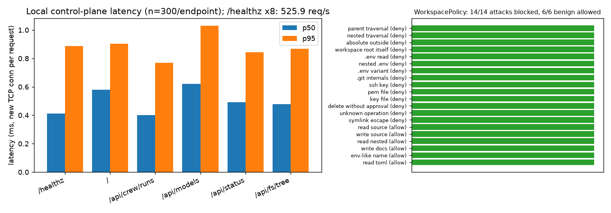
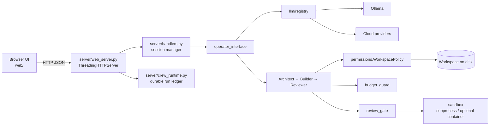

# AgentUFO

**A local-first, dependency-free workspace for running multi-model coding agents. Every file
access passes through an explicit workspace policy, and you can watch each run in the browser.**

[](https://github.com/Cyb0rg137ms/AgentUFO/actions/workflows/ci.yml)

[](LICENSE)

<p align="center">
  
</p>
<p align="center"><sub>Measured with <code>agentufo-bench --requests 300</code> on an 8-vCPU Linux box, Python 3.13.5, no model provider configured. Raw data: <a href="docs/assets/bench.json">docs/assets/bench.json</a>.</sub></p>

## Why it matters

Most AI coding tools are either cloud chat windows or opaque autonomous agents. AgentUFO is a
small, auditable middle ground:

- **Runs locally.** The core server uses only the Python standard library. It works with Ollama
  or with any API key you configure.
- **Bounded access.** Path traversal, secret files and deletes are denied by default.
- **Observable runs.** Runs are recorded in a durable ledger with events, budgets and a review gate.
- **Honest about cost.** Token counts and costs are labelled as estimates when the provider
  doesn't report them.

## Key results

These are all real measurements from this repository. They contain no model-quality claims.

| Metric | Value | Reproduce |
|---|---|---|
| `/healthz` latency p50 / p95 (new TCP connection per request) | 0.41 / 0.89 ms | `agentufo-bench --requests 300` |
| UI shell `/` p50 / p95 | 0.58 / 0.90 ms | same |
| `/api/models` p50 / p95 | 0.62 / 1.03 ms | same |
| `/api/crew/runs` p50 / p95 | 0.40 / 0.77 ms | same |
| `/healthz` throughput, 8 concurrent clients | 525.9 req/s (p95 4.46 ms) | same |
| Workspace-policy attack corpus blocked | 14 / 14 | same (`policy` section) |
| Benign workspace requests allowed | 6 / 6 | same |
| Test suite | 71 passed, 2 skipped (container tests need Docker) | `pytest -q` |

The latencies cover the local HTTP control plane only. A real run is dominated by model-provider
latency, which this benchmark does not measure.

## Architecture



[docs/ARCHITECTURE.md](docs/ARCHITECTURE.md) has the full component diagram.

## 60-second quickstart

```bash
git clone https://github.com/Cyb0rg137ms/AgentUFO && cd AgentUFO
python -m venv .venv && . .venv/bin/activate
pip install -e ".[bench]"
agentufo-bench --requests 50 --plot bench.png   # offline, no model needed
agentufo --no-browser                           # http://127.0.0.1:8000
```

To use a local model, run `ollama serve` and pull one, for example `ollama pull qwen2.5-coder:7b`.
To use a cloud model, set an API key in Settings or `.env`.

Docker (CPU only; publish to loopback only):

```bash
docker build -t agentufo . && docker run --rm -p 127.0.0.1:8000:8000 agentufo
```

## Usage

```python
from agent_core.permissions import PermissionDenied, WorkspacePolicy

policy = WorkspacePolicy("/path/to/project")
policy.resolve("src/app.py", "write")  # -> absolute Path
try:
    policy.resolve("../.ssh/id_rsa", "read")
except PermissionDenied as exc:
    print(exc)  # Path traversal is denied
```

- `agentufo [--host 127.0.0.1] [--port 8000] [--provider auto|ollama|openai|...] [--model TAG] [--no-browser]`
  starts the server.
- `agentufo-bench [--requests N] [--concurrency C] [--json out.json] [--plot out.png] [-v]` runs
  the offline benchmark. It exits non-zero if any policy decision is wrong.
- `examples/policy_and_bench.py` is a runnable example.
- [docs/OPERATIONS.md](docs/OPERATIONS.md) covers operations, and the REST endpoints are in `server/web_server.py`.

## Design decisions and trade-offs

- **Stdlib-only server.** `http.server` keeps installation to zero dependencies and makes the code
  easy to audit. The trade-off is that it is not suited to multi-user or high-concurrency
  deployments.
- **Deny-by-default file policy.** Glob deny-lists are applied before allow-lists, and symlinks
  are resolved before the containment check. Deletes need explicit approval.
- **Serial crew.** Architect, Builder and Reviewer run one after another. Parallel builders were
  deliberately left out until merge and rollback semantics are verified
  ([docs/PERFORMANCE.md](docs/PERFORMANCE.md)).
- **Fail closed on routing.** If an explicitly chosen model is unavailable, the run fails rather
  than silently switching to a paid cloud model.
- **Benchmark scope.** The benchmark measures only what can be reproduced offline. Model-routing
  quality has a harness (`agent_core/routing_benchmark.py`) but no published numbers.

## Limitations and roadmap

These are the main limitations. [docs/LIMITATIONS.md](docs/LIMITATIONS.md) and [SECURITY.md](SECURITY.md) have the full list.

- The subprocess runner is **not** an OS sandbox. Use the container runtime or a VM for
  untrusted code.
- It is meant for a single user on loopback only. There is no authentication or CSRF protection.
- In-flight provider calls can't be cancelled.
- Typing debt remains in 15 legacy modules. They are excluded from the mypy gate.

Roadmap:

- cancellable streaming providers
- authentication for non-loopback use
- published routing benchmarks against real providers
- removal of the mypy exclusions

The previous long-form README is kept in [docs/README_v1.md](docs/README_v1.md).

## Citation

```bibtex
@software{agentufo,
  author = {Cyb0rg137ms},
  title  = {AgentUFO: a local-first multi-agent developer workspace},
  year   = {2026},
  url    = {https://github.com/Cyb0rg137ms/AgentUFO}
}
```

## License

Apache License 2.0. See [LICENSE](LICENSE). The repository was already Apache-2.0 licensed, and that licence is kept unchanged.
