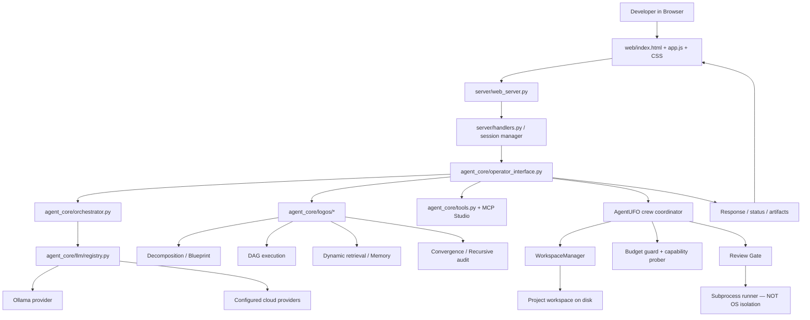

# AgentUFO Studio — End-to-End Architecture

This document describes the pipeline represented by the current source tree. It is an implementation map, not a claim that every optional subsystem has been independently benchmarked.

## Request-to-result path

## Main subsystems

- **Web client:** `web/` contains the Control Room, live crew board, model routing, Ollama setup, workspace explorer/editor, styles, and browser-side API calls.
- **HTTP/API layer:** `server/web_server.py` owns HTTP lifecycle and routing; `server/handlers.py` contains request/session orchestration and API behavior.
- **Operator/orchestration:** `agent_core/operator_interface.py` coordinates user-facing work; `agent_core/orchestrator.py` supplies task orchestration.
- **Provider layer:** `agent_core/llm/` contains provider contracts, Ollama integration, cloud adapters, and the registry. Cloud credentials are optional; never commit them.
- **LOGOS modules:** `agent_core/logos/` contains decomposition, convergence, DAG scheduling, dynamic retrieval, MERA-style reasoning, memory, topology, pondering, auditing, and the experimental Qdit/tensor-network code.
- **Crew pipeline:** `agent_core/agentufo_swarm.py` coordinates Architect/Builder/Reviewer roles, persistence, and review-gate interaction. `bridgemind_swarm.py` remains included for compatibility/experimentation.
- **Workspace and review:** `workspace_manager.py` manages project file operations and locks; `review_gate.py` runs configured checks; `sandbox.py` wraps subprocess execution.
- **Tools/MCP:** `tools.py` and `mcp_studio.py` expose tool integrations. Treat external tool output as untrusted input.

## Recommended engineering lifecycle

1. **Initialize:** validate configuration and identify the chosen provider/model.
2. **Understand:** gather bounded workspace context and relevant memory/retrieval results.
3. **Plan:** decompose the request and declare dependencies/interfaces before parallel work.
4. **Execute:** use the selected provider(s) and tools under token/output/time limits.
5. **Stage changes:** keep changes reviewable; do not let an agent's self-report count as verification.
6. **Verify:** parse/lint/test the actual candidate and preserve logs. Model agreement cannot override a failing deterministic check.
7. **Review:** show a diff and explicit approval state before applying consequential changes.
8. **Commit/report:** record modified paths, test results, model/provider usage where measurable, and unresolved risks.
9. **Recover:** persist run status, support cancellation, and distinguish retryable provider failures from code/test failures.

Not every lifecycle stage is yet implemented with full transactional isolation. Read `OVERHAUL_REPORT.md` and `SECURITY.md` before running generated code.
